## Set Up and Invite

This page shows every step, from the first phone to the rest of the family. The screenshots follow a made-up person, *Alex*, from a parent's phone and a grandparent's phone.

You need a running hub (see [Get a Hub](lf-hub-get.md)) and, on every phone, *LoopFollow* with *LF Hub* on *iOS* 26 or newer.

- - -

## Part 1: The first phone (admin)

Use a phone where *LoopFollow* already shows the glucose data: *Nightscout* and/or *Dexcom Share* work, and an APN key is set under *Settings* → *APN*. The hub takes the data source from this phone.

### Open *LF Hub*

Tap *Menu* → *Settings* → *LF Hub*. It is the last row under *Data Settings*.

The page has two parts. *Join with Invite* is for family members. *Set Up as Owner* is for you, and makes this phone an admin.

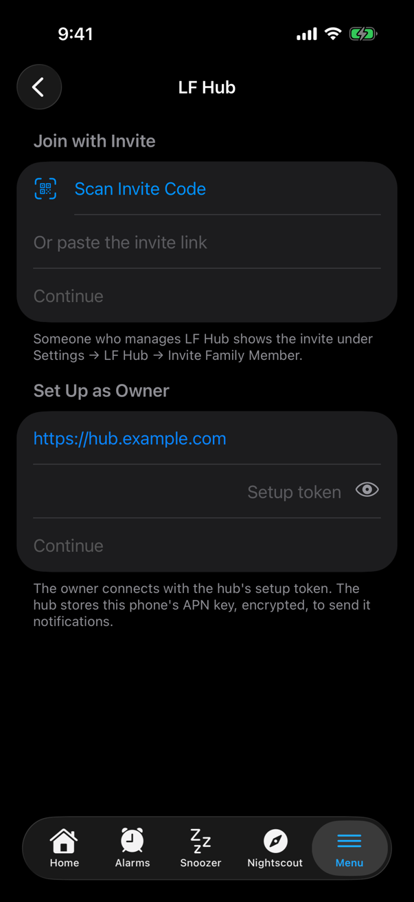{width="350"}
{align="center"}

### Enter the hub's address and setup token

Under *Set Up as Owner*:

1. Enter the hub's address, for example `https://hub.example.com`. Your provider gives it to you, or it is the address you set up yourself.
1. Enter the setup token.
1. Tap *Continue*.
1. On a new hub, enter the name of the person you follow and a name for this phone. Everyone who manages the hub sees the phone's name in the list of phones.
1. Tap *Connect*.

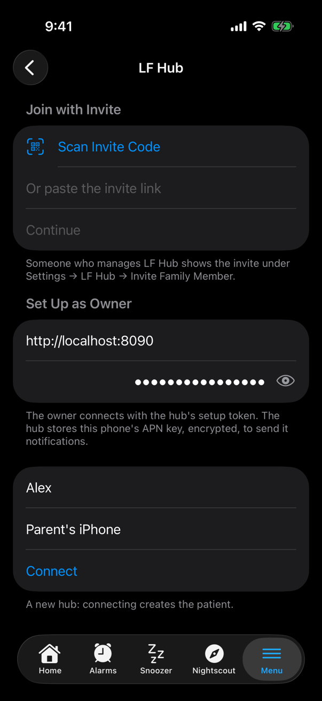{width="350"}
{align="center"}

!!! warning "Keep the setup token secret"
    Anyone with the setup token can join as an admin, take over any phone on the hub and read the person's data source settings. Don't give it to family members. They join with an invite instead.

The screenshots on this page come from a test hub on a computer, so the address is `http://localhost:8090`. Your hub's address starts with `https://`.

### Use *LF Hub* for *Background Refresh*

*LoopFollow* asks if the hub should take over. Tap *Use LF Hub*. You can change this later under *Settings* → *Background Refresh*.

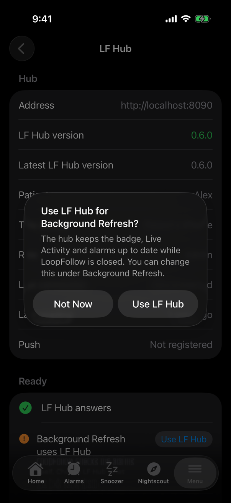{width="350"}
{align="center"}

### Let alarms ring through silent mode

*iOS* asks if *LoopFollow* may schedule alarms. Tap *Allow*. This lets the hub's alarms ring when the phone is silenced or a *Focus* is on.

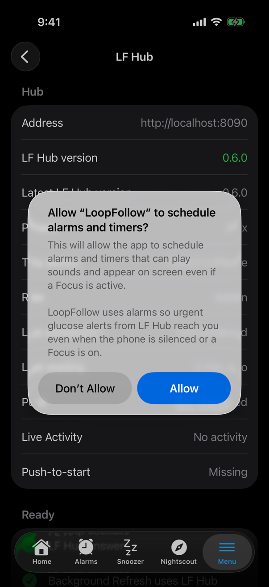{width="350"}
{align="center"}

### Work through the *Ready* list

The *LF Hub* page now shows the hub, the person you follow and this phone. Scroll down to the *Ready* list. Each row turns green when it is done:

* *LF Hub answers*
* *Background Refresh uses LF Hub*
* *Notifications allowed*
* *Alarms ring through silent mode*
* *Live Activity on*
* *APN key added* (or *APN key shared by an admin* on a family member's phone)
* *Notifications from LF Hub arrive*
* *LF Hub reads Alex's data*
* *LF Hub sends this phone's alarms*

A row that is not done says what is missing, often with a button that fixes it.

!!! tip "Test it"
    When every row is green, lock the phone and tap *Send Test Alarm in 30 s* under *Hub Mode*. The alarm should ring even with the phone silenced.

- - -

## Part 2: Invite a family member

Each invite lets one more phone follow the same person. The invite works once and for 24 hours. Make a new one for each phone.

### Make an invite on an admin's phone

On an admin's *LF Hub* page, tap *Invite Family Member*. A QR code appears.

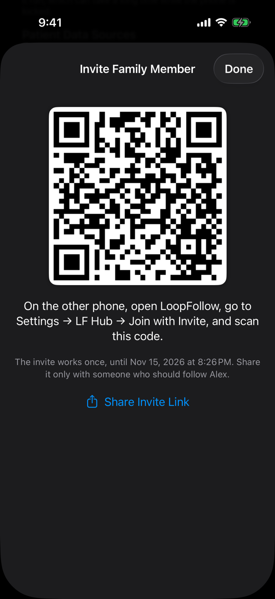{width="350"}
{align="center"}

* If the family member is with you, let their phone scan the code.
* If not, tap *Share Invite Link* and send the link in a private message. Share it only with someone who should follow this person.

- - -

## Part 3: The family member's phone

A family member can join when *LoopFollow* starts for the first time, as shown here, or later under *Settings* → *LF Hub* → *Join with Invite*.

### Choose *Join a Family Hub*

On the *Choose a data source* step, choose *Join a Family Hub* and tap *Continue*.

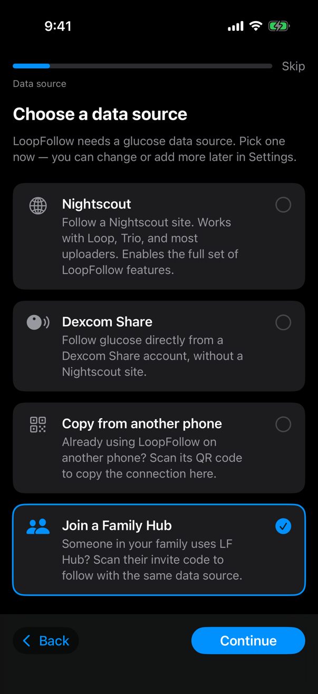{width="350"}
{align="center"}

### Scan the invite

Tap *Scan Invite Code* and point the camera at the QR code on the admin's phone. If you got the invite as a link, paste it in the field instead. Tap *Continue*.

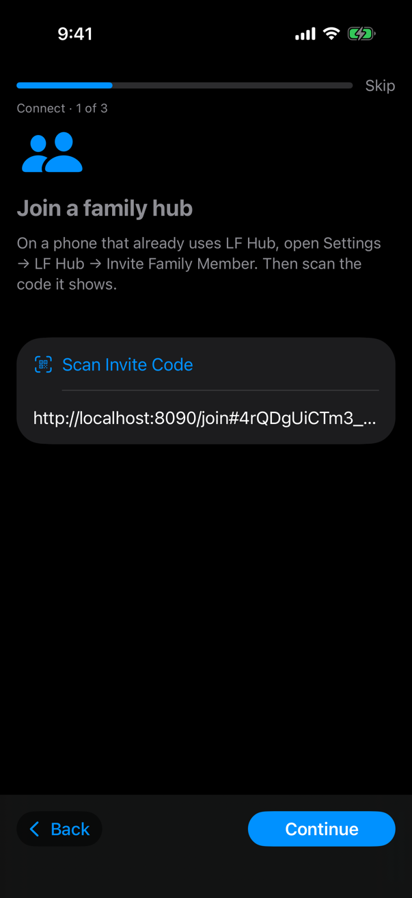{width="350"}
{align="center"}

### Choose how this phone joins

The phone shows which hub and which person the invite is for. Only join a hub you know.

* *Copy settings from …* starts with the same alarms and settings as that phone.
* *Replace …* is for a phone you no longer use. This phone takes over that phone's alarms and settings, and the hub stops recognizing the old phone. If the old phone was used in the last 15 minutes, *LoopFollow* asks first, since it may still be in use. A phone that joins with an invite cannot replace an admin's phone, so this choice only appears for members' phones.
* *Start fresh* gives this phone its own alarms, which you choose in the next steps.

Joining later under *Settings* → *LF Hub* → *Join with Invite* offers the same choices, named *Copy Settings from …*, *Replace …* and *New Device*.

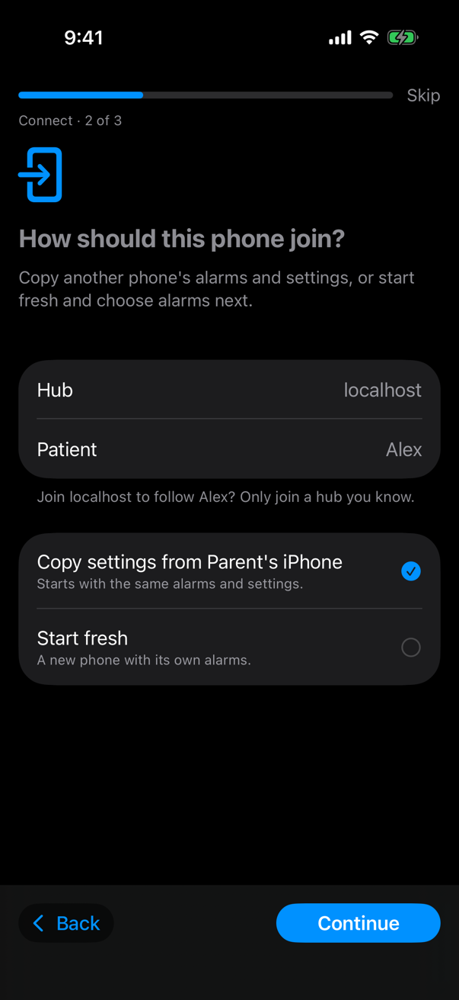{width="350"}
{align="center"}

### Name this phone

Enter a name that tells the admins whose phone it is, and tap *Join*.

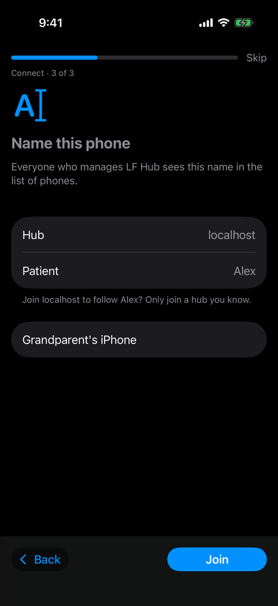{width="350"}
{align="center"}

### Let *LF Hub* reach you

The last step lists the permissions the hub needs on this phone. Tap *Allow* or *Turn On* on each row. *iOS* asks for each permission. Tap *Allow*.

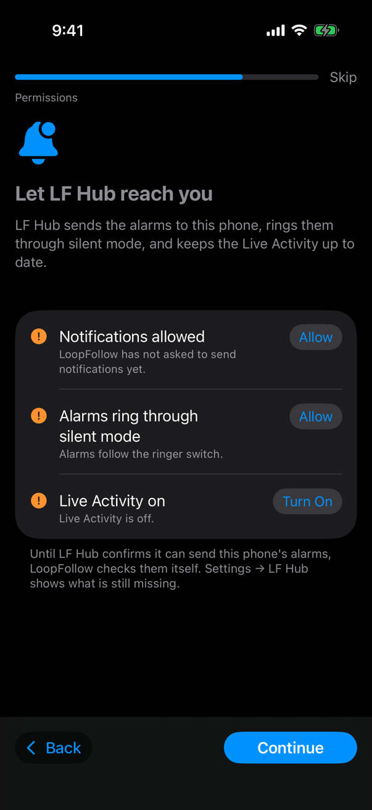{width="350"}
{align="center"}

When all three rows are green, tap *Continue*. *LoopFollow* switches *Background Refresh* to *LF Hub*.

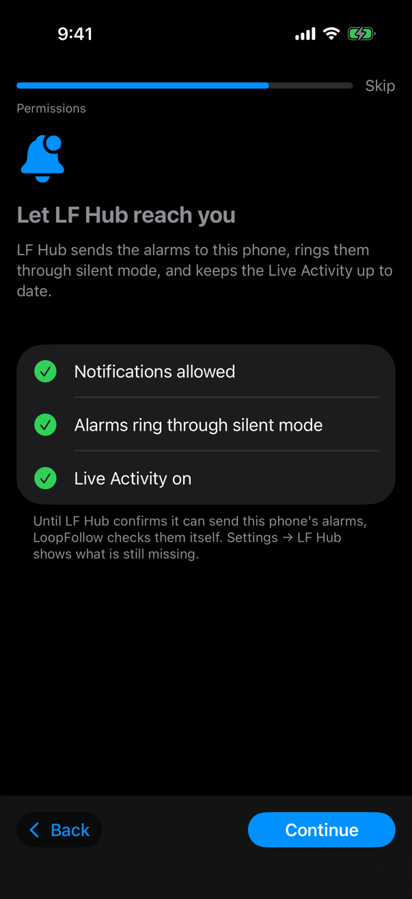{width="350"}
{align="center"}

The family member's phone now follows the person with the hub's data source, with the role *Member*. Its *Settings* → *LF Hub* page has the same *Ready* list as the admin's, and the same test alarm buttons.

- - -

## Part 4: Manage the phones

Every phone that follows the person is listed under *Devices* on an admin's *LF Hub* page.

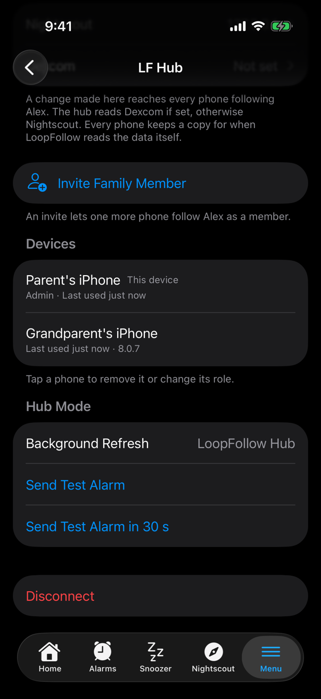{width="350"}
{align="center"}

Tap a phone to:

* *Make Admin*: the phone can then change the data source, invite and manage phones. If the phone you tapped is already an admin, the choice is *Make Member*. The hub always keeps at least one admin.
* *Remove*: the hub stops sending to that phone.

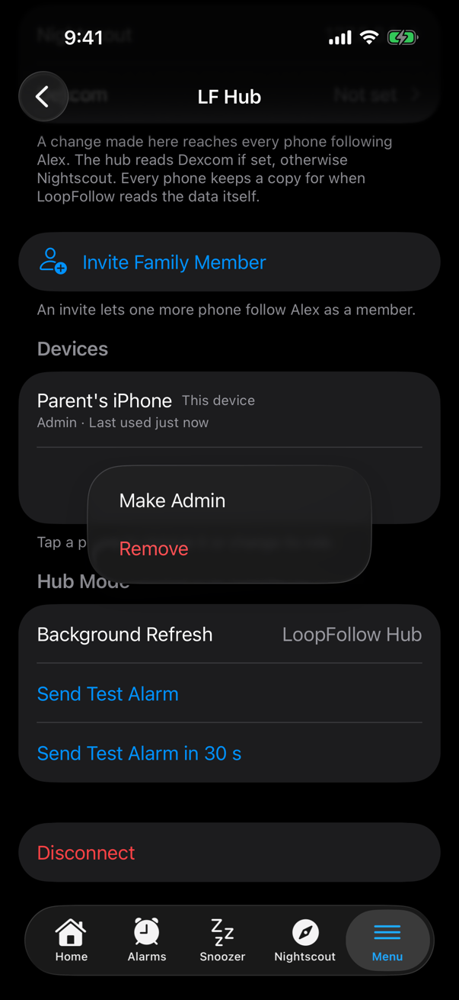{width="350"}
{align="center"}

A *Push failing* warning on a phone in the list means the hub cannot reach it. Open *Settings* → *LF Hub* on that phone and look at its *Ready* list.

### Change the data source

An admin changes the *Nightscout* site or *Dexcom* account under *Patient Data Sources* on the *LF Hub* page. The change reaches every phone that follows the person.

### Leave the hub

*Disconnect* at the bottom of the *LF Hub* page takes a phone off the hub. *LoopFollow* then goes back to checking the alarms by itself.
