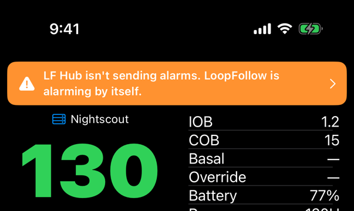

## What is *LF Hub*?

!!! important "In the `dev` branch"
    *LF Hub* is available when you build the `dev` branch of *LoopFollow*. It will come to `main` in a later release. Browser builders need one more identifier first, see [Update for LF Hub](../build/lf-browser-build.md#update-for-lf-hub).

*LF Hub* is a service that runs online around the clock, much like a *Nightscout* site. It watches one person's glucose data for the whole family. It reads the same *Nightscout* site or *Dexcom Share* account that *LoopFollow* reads, and it sends to each family member's iPhone:

* the alarms
* the number on the app icon (the badge)
* the *Live Activity* on the lock screen
* *Speak BG*

It sends them as Apple push notifications, so *LoopFollow* does not have to stay running on the phone.

One hub serves one family and one person. Every phone that follows that person can join the same hub.

!!! warning "Not medical advice"
    *LoopFollow* and *LF Hub* are open-source software that people build and run themselves. They are not medical devices and do not give dosing advice. Alarms depend on the hub, the internet, Apple's push service and the phone, and any of them can fail. Do not rely on *LF Hub* as the only way an alarm reaches you. Talk to your care team about how you use alarms.

- - -

## Why does *LF Hub* exist?

Without a hub, every phone that follows someone has to keep *LoopFollow* running in the background, day and night. *iOS* does not like that. *LoopFollow* uses tricks such as playing silent audio ([Background Refresh](../setup/lf-features.md#background-refresh)) to stay awake, and they cost battery. When *iOS* stops the app anyway, the phone gets no alarms until someone opens *LoopFollow* again, and you see the "App inactive" warnings described in the [FAQs](../faqs/lf-faqs.md).

With *LF Hub*, a server that is always on does the watching. The phones only receive what the hub sends. *LoopFollow* can be closed, the phone can be locked, and the alarms still arrive and ring through silent mode.

- - -

## What you need

* *LoopFollow* with *LF Hub* (the `dev` branch for now) on every phone
* *iOS* 26 or newer on every phone. *LF Hub* alarms are *iOS* system alarms (*AlarmKit*), which need *iOS* 26.
* A hub, either hosted for you or one you run yourself, see [Get a Hub](lf-hub-get.md)
* An APN key in *LoopFollow* under *Settings* → [*APN*](../setup/lf-setup.md#apn) on the phone that sets up the hub. This is the same key that the *Live Activity* and remote commands use.
* Every phone in the family runs *LoopFollow* built with the **same Apple Developer account** as the admin's phone. Those phones use the admin's key and need no key of their own.
    * A phone that joins with an invite never sends its own APN key to the hub. If its *LoopFollow* was built with a **different Apple Developer account**, the admin's key cannot reach it, so it gets no notifications from the hub and *LoopFollow* keeps checking the alarms itself. To use *LF Hub* on that phone, install *LoopFollow* from the same build as the admin.

- - -

## Admins and members

Each phone that joins a hub has a role:

* An **admin** sets the data source (*Nightscout* and/or *Dexcom Share*), invites family members and manages the list of phones. The first phone, connected with *Set Up as Owner*, is an admin. An admin can make another phone an admin too. The hub always keeps at least one admin.
* A **member** follows with its own alarms. The hub gives the member the data source, so a member never types in a *Nightscout* address or a *Dexcom* password. A member cannot change the data source, invite or manage phones.

- - -

## What happens when something goes wrong

*LF Hub* adds a server that has to keep working. *LoopFollow* watches for that:

* Every phone keeps its own copy of the data source. When *LF Hub* is not sending this phone's alarms, *LoopFollow* checks the alarms itself, and an orange banner on the Home screen says so.
* The phone checks that the hub still answers when *iOS* gives it a moment in the background, when you open *LoopFollow*, and while it is open. After 5 minutes without an answer, *LoopFollow* starts checking the alarms itself again. After 20 minutes it raises one alert that the hub has stopped.
* A monitoring service for the hub (see [Get a Hub](lf-hub-get.md)) tells the person who runs it right away when the hub stops.

!!! warning "If the hub stops while the phone is locked"
    The phone only notices a problem when *LoopFollow* gets to run, and while the phone is locked *iOS* decides when that is. It can be a long time. If the hub, its internet connection or Apple's push service stops while the phone is locked, **no alarms may reach the phone** until *iOS* lets *LoopFollow* run again, neither from the hub nor from *LoopFollow*. Opening *LoopFollow* checks the hub right away. See [How LF Hub Works](lf-hub-how-it-works.md#when-something-stops-working).

When *Background Refresh* uses *LF Hub*, the Home screen shows a small server icon before the source name: blue while the hub answers and reaches this phone, red while it does not.

{width="350"}
{align="center"}

The orange banner in this example appears because this phone cannot get push notifications yet. Tap it to see what is missing.

- - -

## Next steps

* [Get a Hub](lf-hub-get.md): hosted for you, or run it yourself
* [Set Up and Invite](lf-hub-onboarding.md): connect the first phone and add the family
* [How LF Hub Works](lf-hub-how-it-works.md): the *Ready* list, what happens when something stops working, and what changes in Hub mode
