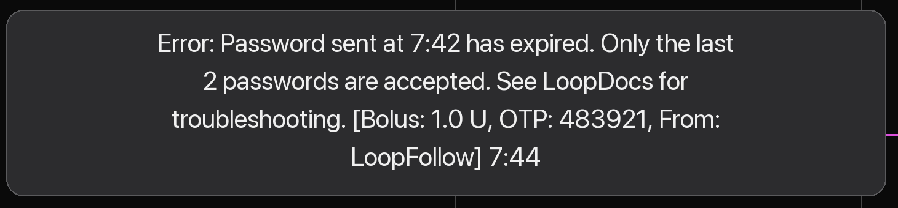

## Remote Command Errors

This page collects the error messages you can meet when sending remote commands from *LoopFollow* to *Loop* or *Trio*, what each one means, and what to do about it.

Errors show up in one of three places:

* **Immediately in *LoopFollow***, as a red message when the command could not even be handed over to *Apple*. These are covered under [Common send errors](remote-control-loop.md#common-send-errors) for *Loop*.
* **As a returned notification** on the *LoopFollow* phone, a few seconds after sending, when the AID phone has processed the command and rejected it. This requires [real-time notifications](remote-control-overview.md).
* **As a gray dot** on the *LoopFollow* main graph, once the AID phone has uploaded the rejection to *Nightscout*. Tap the dot to read the full message. The time shown at the end of the message is when the AID phone processed the command.

!!! warning "A rejected command was not enacted"
    Every message on this page means the AID app refused the command. No insulin was delivered and no carbs were recorded. Before you send again, look at the *LoopFollow* graph to confirm that nothing was enacted, and keep in mind that the person you follow may have treated in the meantime.

- - -

## *Loop* Remote Errors

### "Password sent at HH:MM has expired. Only the last 2 passwords are accepted." { #loop-password-expired }

{width="500"}
{align=center}

The full message reads:

> Error: Password sent at 7:42 has expired. Only the last 2 passwords are accepted. See LoopDocs for troubleshooting. [Bolus: 1.0 U, OTP: 483921, From: LoopFollow] 7:44

#### What it means

Every remote command carries a one-time password (OTP), the six-digit code shown on the *LoopFollow* Bolus and Meal screens. The code changes every 30 seconds, and *Loop* only accepts the code for the **current** 30-second period and the **one before it**. In practice the command has to arrive at the *Loop* phone and be processed within about 30 to 60 seconds of being sent.

The code in this message was a correct code. It was simply too old by the time *Loop* looked at it.

Two times are shown in the message:

| Time | Meaning |
|:--|:--|
| "sent at 7:42" | When *LoopFollow* sent the command |
| "7:44" at the end | When the *Loop* phone processed it |

In this example the command took about two minutes to be processed, far longer than the window allows. The bolus was **not** delivered.

!!! note "A related message: Expired"
    If the delay grows beyond 5 minutes, *Loop* rejects the command with a shorter message that only says **Expired**. The causes and remedies are the same as below.

#### Why it happens

The command travels from *LoopFollow* to *Apple*'s push servers and from there to the *Loop* phone, where *Loop* must wake up and process it. The delay is almost always on the *Loop* phone side:

* **Low Power Mode or a low battery** on the *Loop* phone. iOS postpones background work, including delivering pushes to apps, when the battery is low or Low Power Mode is on.
* **Poor or no network** on the *Loop* phone: a cellular dead zone, a Wi-Fi network without internet, Airplane Mode. *Apple* holds the push and delivers it when the phone is reachable again, which may be minutes later.
* **The phone is busy.** Games, video streaming, or many apps open at once leave less room for iOS to wake *Loop* promptly in the background.
* **The *Loop* app was swiped away** in the app switcher. A force-quit app is not woken for background pushes; the command waits until *Loop* is opened again.
* **Wrong clock on either phone.** The code is derived from the time of day. If the *LoopFollow* phone's clock runs a few minutes behind, or the *Loop* phone's clock runs ahead, a freshly generated code already looks old to *Loop*. The clock on both phones should be set to update automatically.
* **Slow push delivery at *Apple*.** Occasionally a push simply takes longer than usual. There is nothing to fix on either phone; retry.

#### What to do

1. **Confirm nothing was enacted.** A gray dot means the command was rejected. Check that no bolus or carb marker appeared on the graph at the time of your command.
1. **Check the *Loop* phone**, or ask the person who has it:
    * Battery level, and turn off Low Power Mode
    * Network connection: cellular or Wi-Fi with working internet
    * Close games and video apps, or at least make sure *Loop* is not swiped away
    * If someone is holding the *Loop* phone, having *Loop* open in the foreground when the command arrives gives the fastest processing
1. **Send again with a fresh code.** *LoopFollow* shows how many seconds the current code has left. If only a few seconds remain, wait for the next code so the command gets the full window.
1. **If it keeps happening:**
    * Set Date & Time to **Set Automatically** on both phones (iPhone Settings, General, Date & Time)
    * Restart the *Loop* phone
    * Consider the [Remote Window customization](#remote-window-customization) described below

#### Remote Window customization

*Loop and Learn* maintains an optional customization for the *Loop* app that extends the acceptance window for remote commands from about one minute to **10 minutes**. For caregivers who regularly hit this error, this removes most of the time pressure.

The customization is applied when **building *Loop***, so the person who builds the *Loop* app must add it and rebuild. It also changes how *Loop* treats commands that overlap with other treatments, and caregivers have to adjust how they send multiple entries. Read the description carefully and test at home before relying on it:

* [Remote Window on loopandlearn.org](https://www.loopandlearn.org/loop-features-in-development/#remote-window){: target="_blank" }

- - -
