## Remote Profiles

With **Profiles** in *LoopFollow* you can look at the therapy profiles saved in *Loop* or *Trio*, choose which one is in use, create, change, rename or delete profiles, and change the weekly scheduled switches between them, all from the caregiver phone.

!!! danger "Profiles change insulin dosing"
    A profile holds the settings *Loop* or *Trio* uses to decide how much insulin to give. Activating a profile, changing the profile that is in use, or a scheduled switch changes insulin dosing **right away**.

    This page explains how the feature works. It is not medical advice. Agree on each profile, on any change to one, and on the scheduled switches with the care team before you use them, and agree with the person using *Loop* or *Trio* (or their family) on who may make remote changes.

!!! info "In development"
    Remote profile editing is new. It needs a *LoopFollow* version that includes it, and a *Loop* or *Trio* version with therapy profiles that accepts the profile commands. See [What you need](#what-you-need).

### Quick Access

* [Words used on this page](#words-used-on-this-page)
* [What you need](#what-you-need)
* [View profiles](#view-profiles)
* [Activate a profile](#activate-a-profile)
* [Create a profile](#create-a-profile)
* [Edit a profile](#edit-a-profile)
* [Rename a profile](#rename-a-profile)
* [Delete a profile](#delete-a-profile)
* [The review screen](#the-review-screen)
* [Scheduled switches](#scheduled-switches)
* [Replies, waiting and refusals](#replies-waiting-and-refusals)

- - -

## Words used on this page

* **Profile**: a named set of four settings. A profile could be called *School*, *Weekend* or *Sport*. Overrides, temp targets and the pre-meal range are **not** part of a profile.
* **Correction range** (a single **glucose target** in *Trio*): the glucose level the app aims for. In *Loop* it is a low and a high value for each time of day; in *Trio* it is one value for each time of day.
* **Carb ratio**: how many grams of carbohydrate one unit of insulin covers, in g/U. A smaller number means more insulin for the same meal.
* **Basal rate**: the steady background insulin the pump gives through the day, in units per hour (U/hr). The basal rates are also stored on the pump.
* **Insulin sensitivity factor (ISF)**: how far one unit of insulin is expected to lower glucose, in mg/dL/U or mmol/L/U. A smaller number means more insulin for the same correction.
* **Time segment**: each setting can change during the day. Each row starts at a time (always on a full or half hour) and lasts until the next row. The first row always starts at midnight.
* **Active profile**: the profile *Loop* or *Trio* is dosing with right now. There is always exactly one.
* **Default**: the profile that always exists. Before any other profile is made, Default is the active one and holds the settings that were already in the app. Default can be edited but not renamed or deleted.
* **Scheduled switch**: a weekly start of a profile, for example *School starts every Monday at 7:00 AM*. The profile stays active until the next start.

- - -

## What you need

### On the caregiver phone

* *LoopFollow* with remote control set up for *Loop* (see [Loop Remote Control](remote-control-loop.md)) or for *Trio* (see [Trio Remote Control](remote-control-trio.md)).
* A *LoopFollow* version that includes remote profile editing.
* Face ID, Touch ID or a passcode on the phone. Every profile command must be confirmed with one of them.

### For *Loop*

* A *Loop* version with therapy profiles (Settings → Profiles). Therapy profiles are not yet part of a released *Loop* version; they are proposed for *Loop*'s development branch.
    * A *Loop* built with the older **Profile Save & Load** customization (added with the Loop and Learn Customization Select script) lets *LoopFollow* show and activate profiles, but not create, edit, rename or delete them, or change scheduled switches. See [Profiles Customization](https://www.loopandlearn.org/loop-features-in-development/#profiles).
* Remote commands set up and working in *Loop* (the same set-up as remote carbs and bolus).
* A pump connected in *Loop*, and a **maximum basal rate** set in *Loop*'s Therapy Settings.

*Loop* tells *LoopFollow* which profile commands it accepts. If it accepts none, the **Profiles** button is gray. Tapping it shows *Profiles Not Available* and the reason.

### For *Trio*

* A *Trio* version with **Therapy Profiles** (Settings → Therapy Settings → Therapy Profiles). Therapy profiles are in *Trio*'s development branch (`dev`) since November 2026.
* *Trio* Remote Control enabled on the *Trio* phone, with the same shared secret in *LoopFollow*.
* A pump connected in *Trio*.

The **Profiles** button only appears on the *Trio* Remote Control screen when *Trio* says it accepts profile commands.

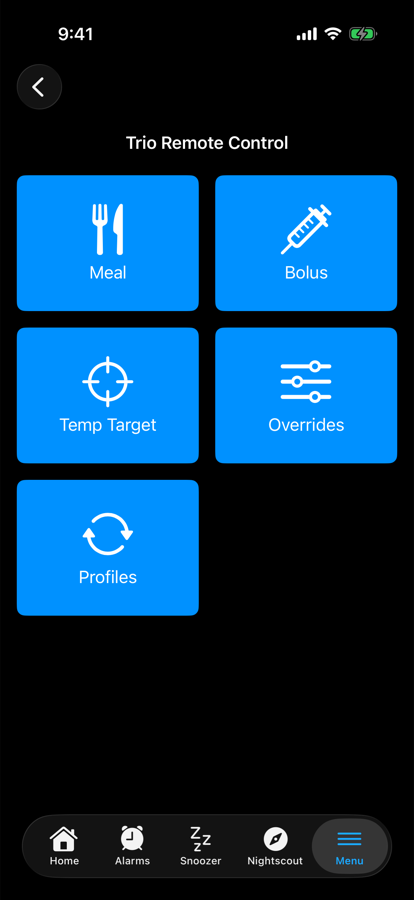{width="300"}
{align=center}

### Limits from the app

*Loop* and *Trio* upload the limits *LoopFollow* must follow: the allowed values for each setting, the basal rates the pump supports, the maximum basal rate, the most time segments, and the glucose unit. Without these limits, *LoopFollow* only shows the profiles and explains why they can't be changed. *Loop* shares the limits once a pump and a maximum basal rate are set up in it.

- - -

## View profiles

Open the *Loop* or *Trio* remote screen and tap **Profiles**.

| Profile list | Scheduled switches |
|:--:|:--:|
| 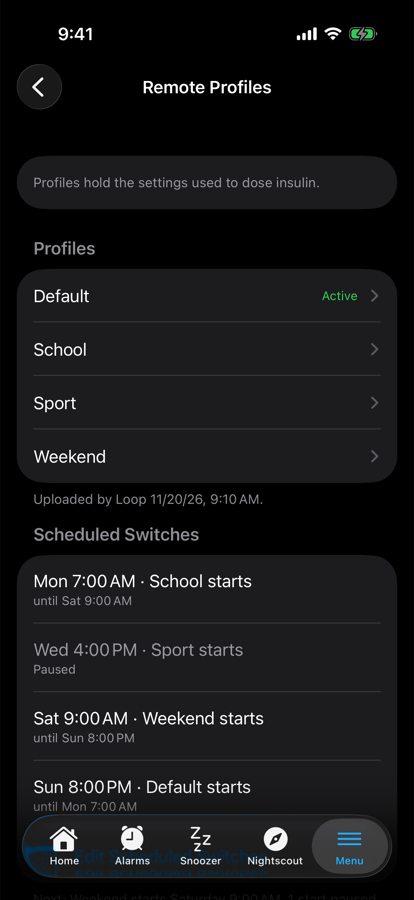{width="300"} | 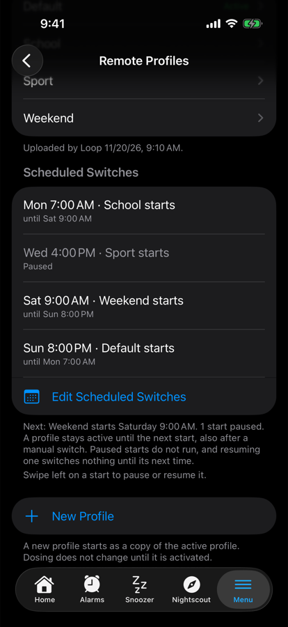{width="300"} |

* **Profiles** lists every profile. The one in use is marked **Active**.
* Below the list is the time *Loop* or *Trio* last uploaded the profiles to *Nightscout*. *LoopFollow* shows what was uploaded, so a change made on the looper's phone a moment ago may not be visible yet.
* **Scheduled Switches** shows the weekly starts. See [Scheduled switches](#scheduled-switches).
* **New Profile** creates a profile. See [Create a profile](#create-a-profile).

Tap a profile to see its correction range (or glucose target), carb ratios, basal rates (with the total per day) and insulin sensitivities, in the units the app uses. Glucose values in mmol/L are shown with one decimal.

| A profile that is not active | Actions at the bottom |
|:--:|:--:|
| 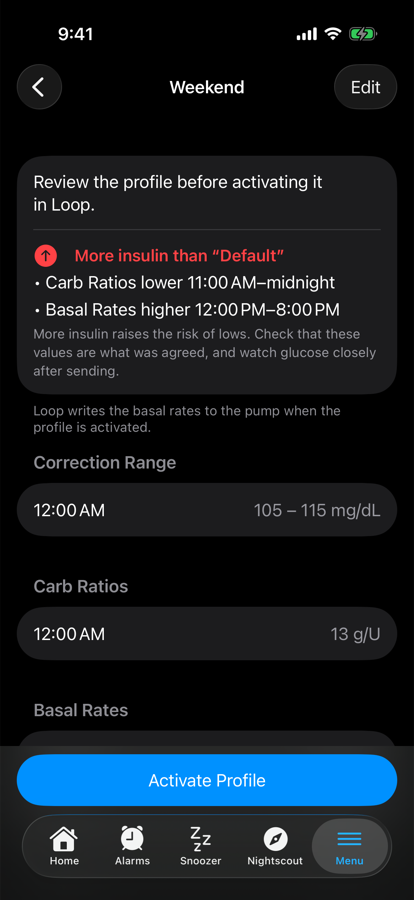{width="300"} | 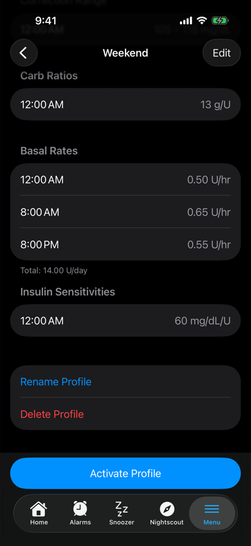{width="300"} |

If the profile would give more insulin than the active profile at some time of day, a red **More insulin than "..."** box lists where: for example higher basal rates, lower carb ratios, lower insulin sensitivities or a lower correction range, and the basal total per day.

**Edit** (top right) opens the editor. **Rename Profile** and **Delete Profile** are at the bottom. **Activate Profile** is the large button.

- - -

## Activate a profile

Activating a profile makes it the one *Loop* or *Trio* doses with.

1. Tap the profile in the list and check its values.
1. Tap **Activate Profile**. A confirmation says what will happen. If scheduled switches are set up, it also says until when the profile stays active, and it repeats any more-insulin warning.
1. Tap **Activate**, then confirm your identity with Face ID, Touch ID or your passcode. Only then is the command sent.

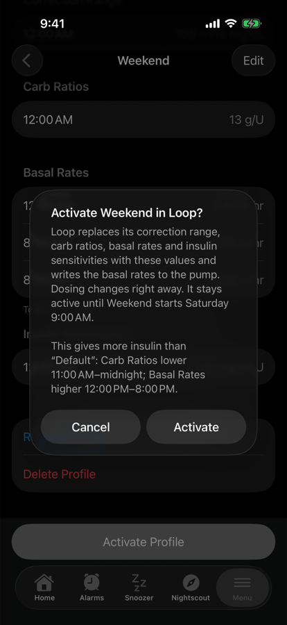{width="300"}
{align=center}

On the looper's phone, the app checks the profile again. It then writes the profile's basal rates to the pump, and only after the pump has accepted them does it start using all four settings. If any step fails, for example because the pump can't be reached, nothing changes and you get a reply saying why.

The active profile's name is shown on the *Loop* status screen and on the *Trio* home screen.

- - -

## Create a profile

1. In the profile list, tap **New Profile**.
1. Enter a name. A name can be up to 32 characters. It can't be "Default", can't contain a period (.), can't start with $, and must differ from the other profiles' names.
1. Under **Start From**, choose the profile to copy. It starts as a copy of the active profile. Choosing another profile discards changes you made below.
1. Change the values you have agreed on (see [Edit a profile](#edit-a-profile) for how the editor works).
1. Tap **Review**, check everything, then tap **Send to *Loop*** (or *Trio*), confirm, and confirm your identity.

A new profile is only saved. Dosing does not change until the profile is activated.

There can be at most 20 profiles, Default included. At 20, **New Profile** is unavailable until a profile is deleted.

{width="300"}
{align=center}

- - -

## Edit a profile

Open a profile and tap **Edit**.

!!! danger "Editing the active profile changes dosing immediately"
    If you edit the profile that is active, a red warning is shown at the top. *Loop* or *Trio* sends the new basal rates to the pump and starts using **all** the new values as soon as it gets the command. There is no separate "activate" step.

    Editing a profile that is not active only changes the saved profile. Dosing does not change until that profile is activated.

| The editor for the active profile | Changing a basal rate |
|:--:|:--:|
| 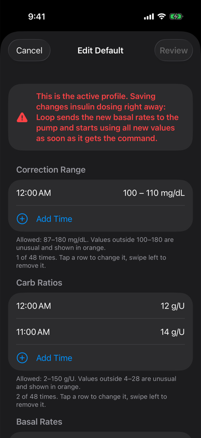{width="300"} | 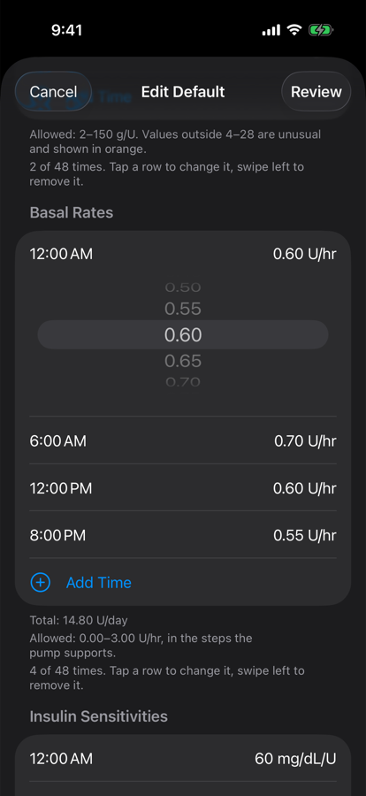{width="300"} |

* Each setting is a list of times. Tap a row to open pickers for its start time and value, and tap the row again to close them. Tap **Add Time** to add a row, and swipe left on a row to remove it. The first row always starts at midnight and can't be removed.
* For *Trio*, each time has one **Glucose Target** value instead of a low and a high value.
* The values you can choose come from the limits *Loop* or *Trio* uploaded. Under each setting you see what is allowed, and how many times are used out of the maximum. Basal rates only offer the steps the pump supports, up to the maximum basal rate, and show the total per day.
* Values the app allows but considers unusual are shown in **orange** with *Unusual value. Double-check it.*
* Values that are not allowed are shown in red with *Outside what is allowed. Change this value before sending.* Everything that must be fixed is also listed under **Fix Before Sending**, and **Review** stays unavailable until it is fixed.
* Tap **Review** to continue. Nothing is sent before the review.

| An unusual value | A *Trio* glucose target |
|:--:|:--:|
| 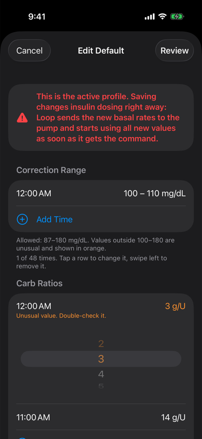{width="300"} | 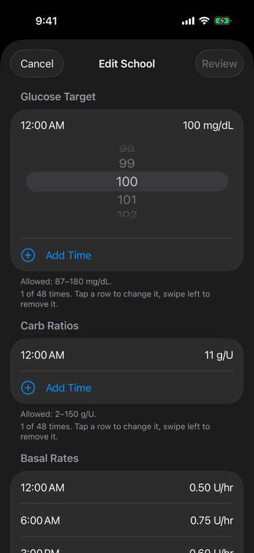{width="300"} |

- - -

## Rename a profile

Open the profile, tap **Rename Profile**, enter the new name and tap **Review**. The review says *Rename "..." to "..."*. The values stay the same, so dosing does not change, and an active profile stays active. Scheduled switches follow the new name. The Default profile can't be renamed.

- - -

## Delete a profile

Open the profile, tap **Delete Profile**, tap **Delete** in the confirmation, then confirm your identity. A deleted profile can't be brought back from *LoopFollow*.

If the profile is used by scheduled switches, the confirmation says so: those starts are removed too, and at those times the profile that was active before stays active until the next scheduled start.

The active profile and the Default profile can't be deleted, so **Delete Profile** is not offered for them. To delete the active profile, first activate another one.

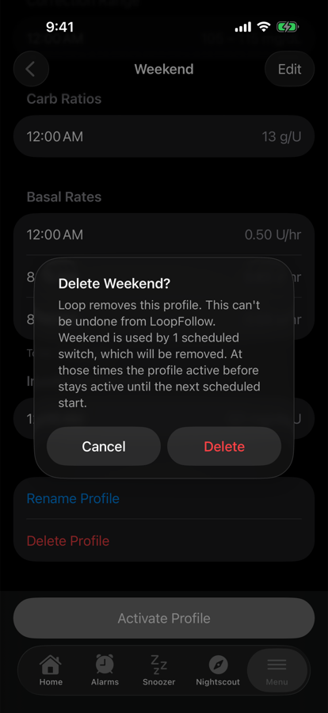{width="300"}
{align=center}

- - -

## The review screen

Every create, edit and rename goes through **Review** before anything is sent.

| Top of the review | The changes |
|:--:|:--:|
| {width="300"} | 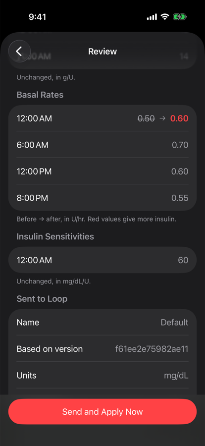{width="300"} |

* A summary says what will happen: create the profile from the one it starts from, save changes to it, or rename it.
* If it is the **active** profile, a red warning says that dosing changes right away, and the button reads **Send and Apply Now** in red. Otherwise it reads **Send to *Loop*** (or *Trio*).
* If the change gives more insulin at some time of day, a red **More insulin than "..."** box lists where, compared with the profile before the change (or the profile a new one starts from).
* Each setting lists its times. Changed values are shown as the old value crossed out, an arrow and the new value. A new value that gives more insulin is red; other changes are orange. Unchanged settings say *Unchanged*.
* **Sent to *Loop*** (or *Trio*) shows the name, the old name for a rename, the version of the profile the change is based on, the units, and **Exact values** with the data that will be sent.
* **Can't Send** lists anything that must be fixed first.
* A remote command must fit in one push notification. The footer shows the size of the command. If a profile has too many time segments to fit, *LoopFollow* says so and won't send it. Use fewer time segments, or make the change on the looper's phone.

When you tap the send button, a confirmation repeats what will happen. After **Send**, *LoopFollow* first loads the profiles again from *Nightscout*. If the profile changed, disappeared, or became active or inactive while you were editing, nothing is sent and you are asked to review it again. Otherwise you confirm your identity, and the command is sent.

- - -

## Scheduled switches

A scheduled switch starts a profile at the same time every week, for example *School* every Monday at 7:00 AM and *Weekend* every Saturday at 9:00 AM. The profile stays active until the next start, also when someone switches profile by hand in between.

!!! warning "Scheduled switches change dosing without anyone looking"
    At each start, *Loop* or *Trio* switches profile by itself, also when nobody is looking at the phone. Agree on the schedule, and on each profile in it, with the care team.

The list of starts is under **Scheduled Switches** in the profile list (see [View profiles](#view-profiles)). Each start shows its day and time, the profile, and until when that profile stays active. Paused starts are gray. Below the list, *LoopFollow* says which start runs next and how many are paused. The times are in the profile's time zone; when that differs from the caregiver phone's, a note says so.

### Pause or resume a start

Swipe left on a start and tap **Pause** (or **Resume**). A review shows the change and the week after saving. Tap **Send to *Loop*** (or *Trio*), confirm, and confirm your identity.

A paused start does not run until it is resumed. Nothing switches when a start is resumed; it runs again at its next time.

| Swipe to pause | Review of the change |
|:--:|:--:|
| 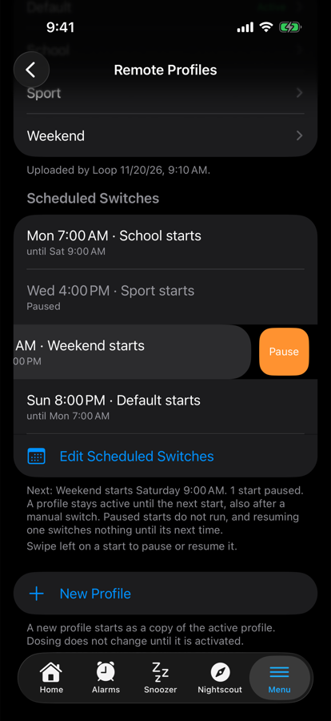{width="300"} | 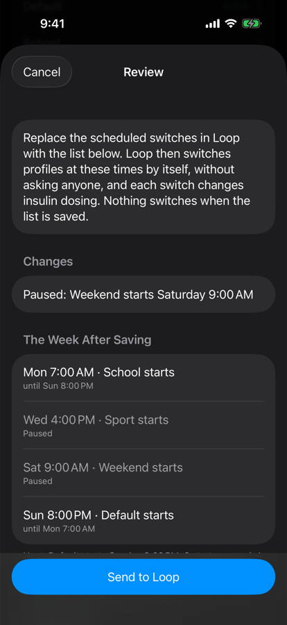{width="300"} |

### Change the starts

Tap **Edit Scheduled Switches**.

| The starts | One start |
|:--:|:--:|
| 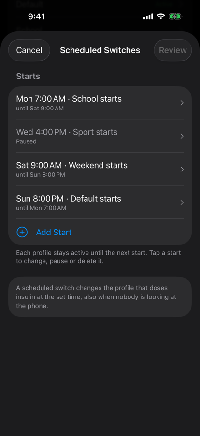{width="300"} | 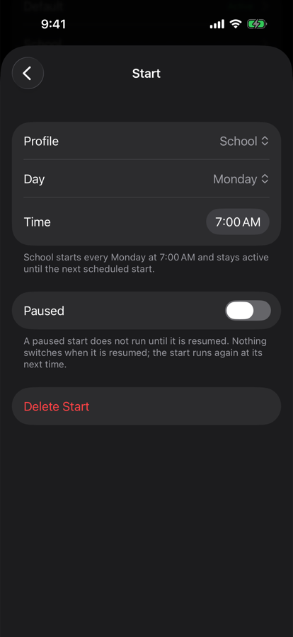{width="300"} |

* Tap a start to change its profile, day and time, to pause it, or to delete it with **Delete Start**. You can also swipe left on a start to delete it.
* Tap **Add Start** to add one. There can be at most 14 starts.
* Only one profile can start at a given day and time. Problems are listed under **Fix Before Sending**.
* Tap **Review**. The review lists the changes (added, changed, removed, paused, resumed), the week after saving, and a red warning for each profile that would start and gives more insulin than Default.

Saving the list switches nothing right away. The new starts run at their next times.

Scheduled switches can only be viewed, not changed, when *Loop* or *Trio* hasn't said it accepts changes to them, or when *LoopFollow* could not read the uploaded list completely. A note under the list says why.

- - -

## Replies, waiting and refusals

Only one profile command can be pending at a time. While *LoopFollow* waits, the button shows *Waiting for Loop...* (or *Trio*), and other profile buttons show *Another Profile Command Is Pending*.

**Replies** come back as a notification and an alert: *Profile Activated*, *Profile Saved*, *Profile Deleted*, *Scheduled Switches Saved*, or *Profile Not Activated* / *Not Saved* / *Not Deleted* / *Scheduled Switches Not Saved* with the reason. *Loop* and *Trio* also post a note in *Nightscout*, and show a notification on the looper's phone.

**Reply lost**: if the reply push doesn't arrive but the profiles *Loop* or *Trio* uploads to *Nightscout* show the change, *LoopFollow* reports the command as done and says that the reply did not arrive.

**No reply**: if no reply arrives within 3 minutes, *LoopFollow* shows *No Reply From Loop* (or *Trio*). The change may still have been made. Pump communication and push notifications can be slow. Wait for the profile list to update before you send the command again.

**Commands expire**. *Loop* ignores a profile command that arrives more than 5 minutes after it was sent, and *Trio* one that is more than 10 minutes old. *Trio* also refuses a command it has already received.

**Common refusals** (nothing is changed when a command is refused):

* The profile, or the list of scheduled switches, changed on the looper's phone after it was uploaded. Someone changed it on the looper's phone, or another caregiver changed it, after *LoopFollow* loaded it. *LoopFollow* closes the screen and loads the profiles again. Open the profile, check the current values, and make the change again if it is still needed.
* The profile no longer exists: it was renamed or deleted on the phone.
* A profile with the same name already exists: choose another name.
* The active profile or the Default profile can't be deleted.
* Values outside the limits, basal rates the pump doesn't support or above the maximum basal rate, or a correction range below *Loop*'s glucose safety limit.
* Insulin delivery is suspended. Activating a profile or changing the active profile writes basal rates to the pump, which is refused while delivery is suspended. Changes to profiles that are not active still work.
* Pump errors. The app writes the basal rates to the pump before anything else changes, so if the pump can't be reached, the profile is not activated or saved.
* Another profile change is in progress: wait and try again. This also happens while therapy settings are being saved on the looper's phone.

For other remote command errors, see [Remote Command Errors](remote-command-errors.md).

!!! tip "Good practice"
    * Agree with the looper (or their family) when remote profile changes are OK, and tell them when you make one.
    * After a change, check that the profile list shows the new values and the expected active profile, and keep an eye on the glucose afterwards.
    * Keep the care team's plan for each profile, and for the scheduled switches, at hand. *LoopFollow* checks that values are within the app's limits, not that they are right for the person.
