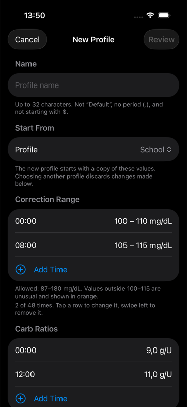
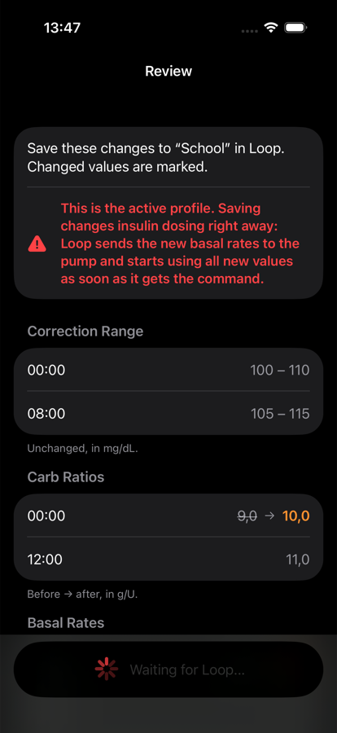

## Remote Profiles

With **Profiles** in *LoopFollow* you can look at the therapy profiles saved in *Loop* or *Trio*, choose which one is in use, and create, change, rename or delete profiles from the caregiver phone.

!!! danger "Profiles change insulin dosing"
    A profile holds the settings *Loop* or *Trio* uses to decide how much insulin to give. Activating a profile, or changing the profile that is in use, changes insulin dosing **right away**.

    This page explains how the feature works. It is not medical advice. Agree on each profile, and on any change to one, with the care team before you use it, and agree with the person using *Loop* or *Trio* (or their family) on who may make remote changes.

!!! info "In development"
    Remote profile editing is new. It needs a *LoopFollow* version that includes it, and a *Loop* or *Trio* version that accepts the profile commands. See [What you need](#what-you-need).

### Quick Access

* [Words used on this page](#words-used-on-this-page)
* [What you need](#what-you-need)
* [View profiles](#view-profiles)
* [Activate a profile](#activate-a-profile)
* [Create a profile](#create-a-profile)
* [Edit a profile](#edit-a-profile)
* [Rename a profile](#rename-a-profile)
* [Delete a profile](#delete-a-profile)
* [The review screen](#the-review-screen)
* [Replies, waiting and refusals](#replies-waiting-and-refusals)

- - -

## Words used on this page

* **Profile**: a named set of four settings. A profile could be called *School*, *Weekend* or *Sport*. Overrides, temp targets and the pre-meal range are **not** part of a profile.
* **Correction range** (called *glucose targets* in *Trio*): the glucose range the app aims for. It is set as a low and a high value for each time of day.
* **Carb ratio**: how many grams of carbohydrate one unit of insulin covers, in g/U. A smaller number means more insulin for the same meal.
* **Basal rate**: the steady background insulin the pump gives through the day, in units per hour (U/hr). The basal rates are also stored on the pump.
* **Insulin sensitivity factor (ISF)**: how far one unit of insulin is expected to lower glucose, in mg/dL/U or mmol/L/U. A smaller number means more insulin for the same correction.
* **Time segment**: each setting can change during the day. Each row starts at a time (always on a full or half hour) and lasts until the next row. The first row always starts at 00:00 (midnight).
* **Active profile**: the profile *Loop* or *Trio* is dosing with right now. There is always exactly one.
* **Default**: the profile that always exists. Before any other profile is made, Default is the active one and holds the settings that were already in the app. Default can be edited but not renamed or deleted.

- - -

## What you need

### On the caregiver phone

* *LoopFollow* with remote control set up for *Loop* (see [Loop Remote Control](remote-control-loop.md)) or for *Trio* (see [Trio Remote Control](remote-control-trio.md)).
* A *LoopFollow* version that includes remote profile editing.
* Face ID, Touch ID or a passcode on the phone. Every profile command must be confirmed with one of them.

### For *Loop*

* A *Loop* build with the therapy profiles feature. Today that is *Loop* `next-dev` with the **Profile Save & Load** customization (`profiles`), added with the Loop and Learn Customization Select script.
    * An older build of the customization (for example on *Loop* 3.14) lets *LoopFollow* show and activate profiles, but not create, edit, rename or delete them.
* Remote commands set up and working in *Loop* (the same set-up as remote carbs and bolus).
* A pump connected in *Loop*, and a **maximum basal rate** set in *Loop*'s Therapy Settings.

*Loop* tells *LoopFollow* which profile commands it accepts. If something is missing, the **Profiles** button is gray. Tapping it shows *Profiles Not Available* and the reason.

### For *Trio*

* A *Trio* version with **Therapy Profiles** (under Settings → Therapy Settings → Therapy Profiles).
* *Trio* Remote Control enabled on the *Trio* phone, with the same shared secret in *LoopFollow*.
* A pump connected in *Trio*.

The **Profiles** button only appears on the *Trio* Remote Control screen when *Trio* says it accepts profile commands.

{width="300"}
{align=center}

### Limits from the app

*Loop* and *Trio* upload the limits *LoopFollow* must follow: the allowed values for each setting, the basal rates the pump supports, the maximum basal rate and the glucose unit. Without these limits, *LoopFollow* only shows the profiles and explains why they can't be changed. The limits appear once a pump and a maximum basal rate are set up in *Loop* or *Trio*.

- - -

## View profiles

Open the *Loop* or *Trio* remote screen and tap **Profiles**.

| Profile list | A profile |
|:--:|:--:|
| {width="300"} | {width="300"} |

* The list shows every profile. The one in use is marked **Active**.
* Below the list is the time *Loop* or *Trio* last uploaded the profiles to *Nightscout*. *LoopFollow* shows what was uploaded, so a change made on the looper's phone a moment ago may not be visible yet.
* Tap a profile to see its correction range, carb ratios, basal rates (with the total per day) and insulin sensitivities, in the units the app uses.

- - -

## Activate a profile

Activating a profile makes it the one *Loop* or *Trio* doses with.

1. Tap the profile in the list to review its values.
1. Tap **Activate Profile** and confirm.
1. Confirm your identity with Face ID, Touch ID or your passcode. Only then is the command sent.

On the looper's phone, the app checks the profile again. It then writes the profile's basal rates to the pump, and only after the pump has accepted them does it start using all four settings. If any step fails, for example because the pump can't be reached, nothing changes and you get a reply saying why.

The active profile's name is shown on the *Loop* status screen and on the *Trio* home screen.

- - -

## Create a profile

1. In the profile list, tap **New Profile**.
1. Enter a name. A name can be up to 32 characters. It can't be "Default", can't contain a period (.), can't start with $, and must differ from the other profiles' names.
1. Under **Start From**, choose the profile to copy. It starts as a copy of the active profile.
1. Change the values you have agreed on (see [Edit a profile](#edit-a-profile) for how the editor works).
1. Tap **Review**, check everything, then tap **Send** and confirm your identity.

A new profile is only saved. Dosing does not change until the profile is activated.

{width="300"}
{align=center}

- - -

## Edit a profile

Open a profile and tap **Edit**.

{width="300"}
{align=center}

* Each setting is a list of times. Tap a row to change its start time or value, tap **Add Time** to add a row, and swipe left on a row to remove it.
* The values you can choose come from the limits *Loop* or *Trio* uploaded. Basal rates only offer the steps the pump supports, up to the maximum basal rate.
* Values the app allows but considers unusual are shown in **orange** with "Unusual value. Double-check it with the care team's plan."
* Values that are not allowed are shown in red, and the change can't be sent until they are fixed.
* Under the list you see how many times are used out of the maximum.
* Tap **Review** to continue. Nothing is sent before the review.

!!! danger "Editing the active profile changes dosing immediately"
    If you edit the profile that is active, *Loop* or *Trio* sends the new basal rates to the pump and starts using **all** the new values as soon as it gets the command. There is no separate "activate" step.

    Editing a profile that is not active only changes the saved profile. Dosing does not change until that profile is activated.

- - -

## Rename a profile

Open the profile and tap **Rename Profile**, enter the new name and tap **Review**. The values stay the same, and an active profile stays active. The Default profile can't be renamed.

- - -

## Delete a profile

Open the profile, tap **Delete Profile** and confirm, then confirm your identity. A deleted profile can't be brought back from *LoopFollow*.

The active profile and the Default profile can't be deleted. To delete the active profile, first activate another one.

- - -

## The review screen

Every create, edit and rename goes through **Review** before anything is sent.

{width="300"}
{align=center}

* A summary says what will happen: create, save changes to, or rename the profile.
* If it is the **active** profile, a red warning says that dosing changes right away, and the button reads **Send and Apply Now**.
* Each setting lists its times. Values that change are shown as old value, crossed out, then an arrow and the new value in orange. Unchanged settings say *Unchanged*.
* **Sent to *Loop*** (or *Trio*) shows the name, the version of the profile the change is based on, the units, and **Exact values** with the data that will be sent.
* **Can't Send** lists anything that must be fixed first.
* A remote command must fit in one push notification. If a profile has too many time segments to fit, *LoopFollow* says so and won't send it. Use fewer time segments, or make the change on the looper's phone.

- - -

## Replies, waiting and refusals

Only one profile command can be pending at a time. While *LoopFollow* waits, the button shows *Waiting for Loop...* (or *Trio*), and other profile buttons show *Another Profile Command Is Pending*.

**Replies** come back as a notification and an alert, for example *Profile Activated*, *Profile Saved*, *Profile Deleted*, or *Profile Not Activated* / *Not Saved* / *Not Deleted* with the reason. *Loop* and *Trio* also post a note in *Nightscout*, and show a notification on the looper's phone.

**No reply**: if no reply arrives within 3 minutes, *LoopFollow* shows *No Reply From Loop* (or *Trio*). The change may still have been made. Pump communication and push notifications can be slow. Wait for the profile list to update before you send the command again.

**Commands expire**. *Loop* ignores a profile command that arrives more than 5 minutes after it was sent, and *Trio* one that is more than 10 minutes old. *Trio* also refuses a command it has already received.

**Common refusals** (nothing is changed when a command is refused):

* *The profile changed on the phone after it was uploaded.* Someone changed the profile on the looper's phone, or another caregiver changed it, after *LoopFollow* loaded it. *LoopFollow* closes the screen and loads the profiles again. Open the profile, check the current values, and make the change again if it is still needed.
* *No profile named ...*: the profile was renamed or deleted on the phone.
* *A profile named ... already exists*: choose another name.
* *The active profile cannot be deleted* / *The Default profile cannot be deleted.*
* Values outside the limits, basal rates the pump doesn't support or above the maximum basal rate, or a correction range below *Loop*'s glucose safety limit.
* Pump errors. The app writes the basal rates to the pump before anything else changes, so if the pump can't be reached, the profile is not activated or saved.
* *Another profile change is in progress*: wait and try again. This also happens while therapy settings are being saved on the looper's phone.

For other remote command errors, see [Remote Command Errors](remote-command-errors.md).

!!! tip "Good practice"
    * Agree with the looper (or their family) when remote profile changes are OK, and tell them when you make one.
    * After a change, check that the profile list shows the new values and the expected active profile, and keep an eye on glucose afterwards.
    * Keep the care team's plan for each profile at hand. *LoopFollow* checks that values are within the app's limits, not that they are right for the person.
