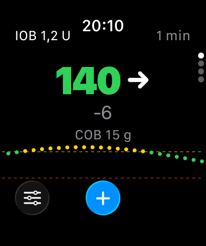
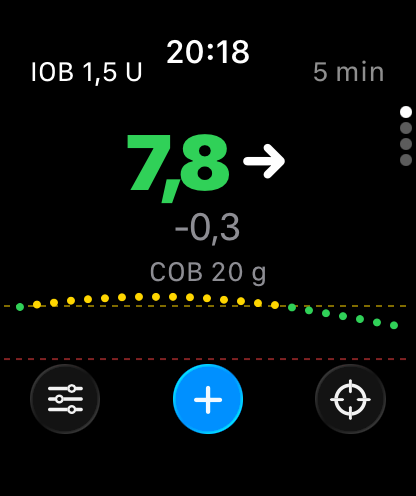
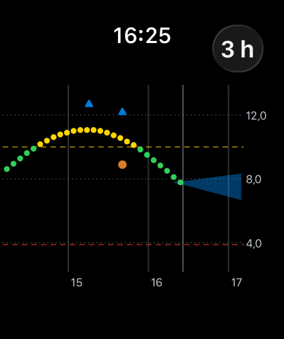
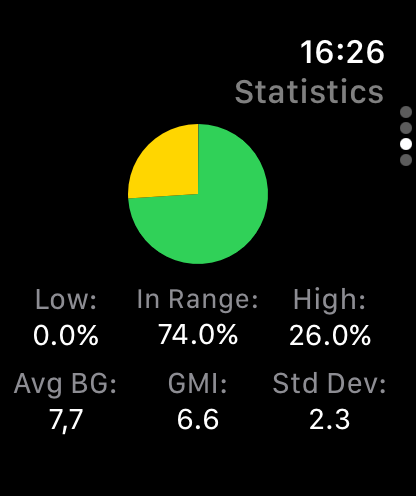
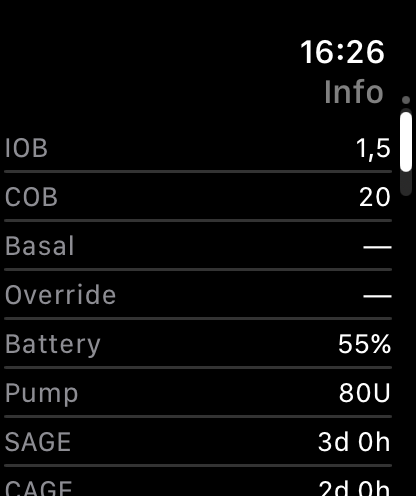
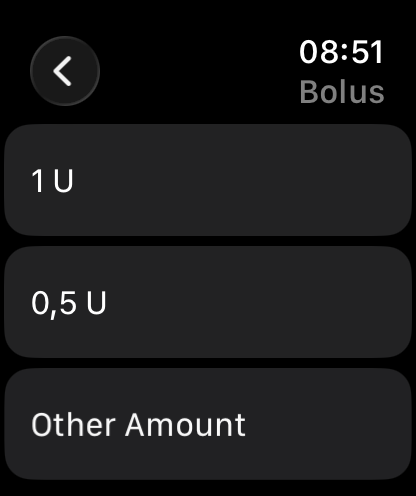
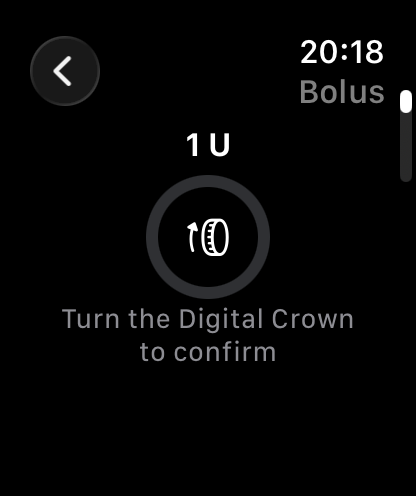
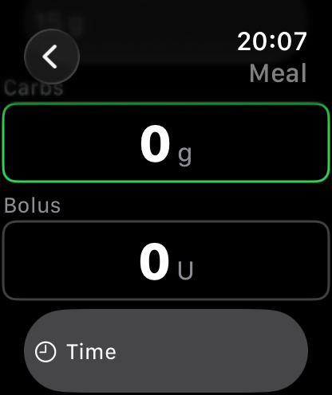
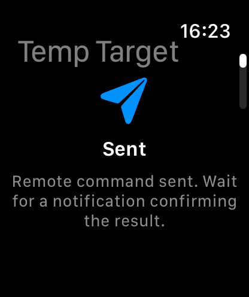
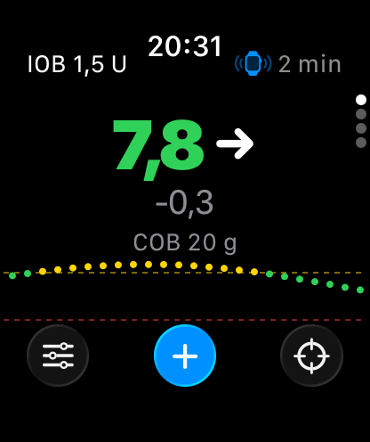

## Apple Watch

*LoopFollow* includes an *Apple Watch* app. It shows the same glucose information as the *LoopFollow* app on your *iPhone*, adds glucose to your watch face, and can send [remote commands](../remote/remote-control-overview.md) to *Loop* or *Trio*.

Normally the watch gets everything from *LoopFollow* on the paired *iPhone*. When the *iPhone* is switched off or out of reach, the watch keeps working on its own over Wi-Fi or cellular, see [Without the iPhone](#without-the-iphone).

!!! info "Requirements"
    * An *Apple Watch* paired with the *iPhone* that runs *LoopFollow*
    * watchOS 10 or newer (Apple Watch Series 4 or newer)

### Install the Watch App

The watch app comes with *LoopFollow*. If it does not appear on your watch after you install or update *LoopFollow*, open the *Watch* app on your *iPhone*, scroll to *Available Apps* and tap *Install* next to *LoopFollow*.

Open the watch app once while the *iPhone* is nearby, so it can receive what it needs to work without the *iPhone*.

## Using the Watch App

Turn the Digital Crown, or swipe up and down, to move between the pages: Glucose, Graph, Statistics and Info.

### Glucose

| Following *Loop* (mg/dL) | Following *Trio* (mmol/L) |
|:--:|:--:|
| {width="200"} | {width="200"} |

* The latest glucose value with its trend arrow and the change since the previous reading
    * Colors follow the *LoopFollow* settings on your *iPhone*: green in range, yellow high, red low, or white when *Color BG Text* is off
    * The value is struck through when the latest reading is 12 minutes old or more
* Top left: insulin on board (IOB)
* Top right: minutes since the latest reading
    * An orange *iPhone* symbol means the watch cannot reach the *iPhone* right now
    * A blue watch symbol means the watch is fetching the data itself
* Carbs on board (COB)
    * *Not looping* is shown in red when the loop has not reported for 15 minutes
* A graph of the last two hours
* Buttons for remote commands at the bottom, see [Remote Commands](#remote-commands)

When an alarm is sounding on the *iPhone*, its name is shown at the top of the page. Tap it to snooze the alarm on the *iPhone*. The watch app has no alarms of its own.

### Graph

{width="200"}
{align="center"}

The graph shows readings, boluses (blue triangles), carbs (orange dots) and the prediction in the same colors as the *iPhone*.

* Tap the button in the top corner to switch between 1, 3, 6, 12 and 24 hours.
* Tap the graph to look back in time: turn the Digital Crown to move the marker, and the time and glucose at the marker are shown above the graph. Tap the graph again to return to now.

### Statistics

{width="200"}
{align="center"}

The same statistics as under the graph on the *iPhone*: time low, in range and high, average glucose, GMI or estimated A1C, and standard deviation.

### Info

{width="200"}
{align="center"}

The *iPhone* info table: the same rows, in the same order, with the same colors as set up in *Info Display* on the *iPhone*.

## Complications

You can add *LoopFollow* to your watch face. Edit the watch face, choose a complication slot and pick *LoopFollow*. All sizes show glucose, trend and the minutes since the reading; the rectangular size also shows a two-hour graph.

watchOS decides how often complications refresh, so a complication can lag behind the watch app. Always check the minutes shown next to the value.

## Remote Commands

!!! warning "Not medical advice"
    Remote commands can deliver insulin. Use them the same way you would from the *iPhone*, and follow the guidance of your diabetes care team.

The buttons on the glucose page send the same commands as the *LoopFollow* remote screens on the *iPhone*. They appear when [Loop Remote Control](../remote/remote-control-loop.md) or [Trio Remote Control](../remote/remote-control-trio.md) is set up in *LoopFollow*.

| Button | What it does |
|:--|:--|
| Overrides (left) | Start one of the override presets, or cancel the active override |
| **+** (middle) | Meal or Bolus |
| Temp Target (right) | *Trio* only: start one of the temp target presets saved in *LoopFollow*, or cancel the active temp target |

### Bolus

| Choose an amount | Confirm with the Digital Crown |
|:--:|:--:|
| {width="200"} | {width="200"} |

* *Recommended* shows the recommendation from *Loop* or *Trio*, as on the *iPhone*. It is hidden when it is 12 minutes old or more, and you are warned when it is 5 minutes old or more.
* The amounts below are your *LoopFollow* Quick-Pick boluses.
* *Other Amount* lets you set any amount with the Digital Crown, up to the *Max Bolus* in *LoopFollow*. Each click of the crown changes the amount by one bolus increment, and the **−** and **+** buttons beside the amount do the same.

### Meal

{width="200"}
{align="center"}

* The rows at the top are your *LoopFollow* Quick-Pick meals.
* Tap *Carbs* and set the amount with the Digital Crown, or with the **−** and **+** buttons beside the amount. Until you tap a field, the Digital Crown scrolls the screen.
* For *Trio*, the same fields as on the *iPhone* follow below carbs: fat and protein when *Meal with Fat/Protein* is turned on, and a bolus when *Meal with Bolus* is turned on in the *LoopFollow* *Remote Settings*. Carbs and bolus are sent together as one command.
* Tap *Time* to log the meal from 2 hours ago to 1 hour ahead. A bolus sent with the meal is given right away, also when the meal is set to another time.
* For *Loop*, the watch sends carbs only, with an absorption time of 3 hours.

### Safety Checks

* Anything that delivers insulin needs a full turn of the Digital Crown to confirm. The watch must have a passcode, *Wrist Detection* must be on, and the watch must be unlocked on your wrist.
* Every command is checked against the same limits as the *iPhone* remote screens, such as *Max Bolus* and *Max Carbs*, before it is sent.
* Commands are never saved to send later, and a command that arrives more than 60 seconds after it was made is ignored.

### After Sending

{width="200"}
{align="center"}

*Sent* means the command has been sent. It does **not** mean that *Loop* or *Trio* has acted on it. Wait for the notification from *Loop* or *Trio* that confirms the result, the same as when you send a command from the *iPhone*. The watch returns to the glucose page after a few seconds.

If something goes wrong, the watch shows the reason and stays on that screen until you tap *OK*. If the *iPhone* does not answer within 30 seconds, the watch says that the command may still have been sent: check *Loop* or *Trio* before you try again.

### Turn Off Watch Commands

Remote commands from the watch are on by default. To turn them off, open *LoopFollow* on the *iPhone*, go to *Remote Settings* and turn off *Allow Commands from Apple Watch*. The watch then shows glucose information only, and the details it needs to send commands on its own are not copied to the watch.

## Without the iPhone

{width="200"}
{align="center"}

The watch normally gets its data and sends its commands through the *iPhone*. When the *iPhone* is switched off or out of reach, the watch carries on by itself:

* **Data**: when the *iPhone* has not sent anything for 10 minutes, the watch fetches glucose, IOB, COB, the prediction and treatments directly from *Nightscout*, or glucose from *Dexcom Share* if you do not use *Nightscout*. A blue watch symbol next to the minutes shows that the watch is fetching on its own. Statistics and the info table keep showing the *iPhone*'s latest values, with the time they are from.
* **Commands**: when the *iPhone* is out of reach, the watch sends the command directly to *Loop* or *Trio*, checked against the limits it last received from the *iPhone*. The confirmation from *Loop* or *Trio* still goes to the *iPhone*, so check *Loop* or *Trio* for the result. Insulin can be sent from the watch alone at most once a minute.
* Snoozing an alarm needs the *iPhone*.

As soon as the *iPhone* is back, the watch switches back to it.

??? info "Why the watch prefers the iPhone (click to open/close)"
    * The *iPhone* checks for new readings more often than watchOS lets a watch app do in the background, so data through the *iPhone* is fresher.
    * The *iPhone* works out the info table, statistics, colors and alarms, so the watch shows exactly what the *iPhone* shows.
    * Using the *iPhone* saves the watch's battery and cellular data, and avoids logging in to *Dexcom Share* from two devices.
    * Commands are checked against the *iPhone*'s settings at the moment they are sent, and the *iPhone* keeps track of *Loop*'s one-time codes for its own remote screens as well.
    * Only one of them sends a command, never both.

!!! note "What is stored on the watch"
    To work without the *iPhone*, the watch keeps a copy of your *Nightscout* address and token, your *Dexcom Share* login, and, when commands from the watch are allowed, the remote control keys. They are sent from the *iPhone* only when they change, are kept in the watch's keychain, and are not included in backups.
